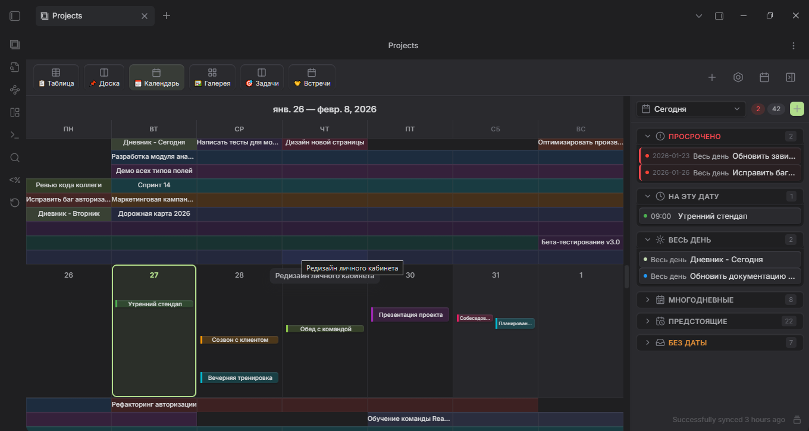

# Projects Plus

[English](README.md) · [Сайт и идеи](https://parkpavel.github.io/obs-projects-plus/) · [Руководство пользователя](docs/user-guide.md) · [Документация](docs/README.md) · [План развития](ROADMAP-RU.md)

Projects Plus помогает работать с заметками Obsidian как с проектом: просматривать записи в таблице, распределять их по колонкам, планировать события в календаре и собирать обзор на Dashboard.

Каждая запись остаётся Markdown-файлом. Поля, например статус, дата и исполнитель, хранятся в свойствах заметки — YAML-блоке в начале файла. Изменение обычного редактируемого поля в плагине записывается в заметку.

Формулы Dashboard добавляют вычисляемые столбцы к данным представления. Они доступны только для чтения и не записывают результат в исходные заметки.

## Состояние разработки

Текущие исходники готовятся к **3.7.2**; это ещё не опубликованный кандидат. Готовую версию скачивайте из [Releases](https://github.com/ParkPavel/obs-projects-plus/releases) и сверяйте с её описанием. Автоматические проверки на ПК и моделирование мобильных размеров не заменяют приёмку на iPhone или Android.

Изменения описаны в [журнале](CHANGELOG-RU.md). Перед обновлением рабочего хранилища прочитайте [руководство по обновлению и откату](docs/upgrade-RU.md).

Если Projects Plus вам полезен, можно [поддержать разработку](https://web.tribute.tg/d/Sh6).

## Что можно сделать

| Задача | Инструмент |
| --- | --- |
| Сравнить записи и изменить их свойства | Таблица в блоке Dashboard |
| Распределить задачи по статусам | Доска с перетаскиванием карточек |
| Посмотреть встречи и сроки | Календарь с обзором от года до дня |
| Просматривать материалы по обложкам | Галерея |
| Объединить данные, графики, показатели и вычисляемые столбцы | Dashboard с настраиваемыми блоками |
| Считать итоги по связанным записям | Свёртки через связь и обратные — «записи, которые ссылаются сюда» |
| Сравнить показатели разных проектов | Графики с несколькими сериями, данными другого проекта и второй осью |
| Выбрать нужные заметки | Папка, тег, встроенный запрос с фильтром или Dataview |



Иллюстрация показывает один из вариантов интерфейса; оформление установленной версии может отличаться.

## Установка

Если Projects Plus доступен в каталоге плагинов сообщества Obsidian, установите его через **Настройки → Сторонние плагины → Обзор**: найдите **Projects Plus**, затем нажмите **Установить** и **Включить**.

Чтобы установить выпуск вручную:

Скачайте опубликованную сборку в разделе [GitHub Releases](https://github.com/ParkPavel/obs-projects-plus/releases). По заметкам к выпуску и [истории изменений](CHANGELOG-RU.md) можно проверить, какие функции в него входят. Нужен Obsidian 1.8.7 или новее.

1. Выберите релиз и скачайте из него **все три файла**: `main.js`, `manifest.json` и `styles.css`.
2. Создайте в своём хранилище папку `.obsidian/plugins/obs-projects-plus/` и поместите туда файлы. Если в Obsidian задана другая папка конфигурации, используйте её вместо `.obsidian`.
3. Перезапустите Obsidian и включите **Projects Plus** в настройках сторонних плагинов.

При обновлении заменяйте эти три файла одной сборкой. Сохраните `data.json`: в нём находятся настройки ваших проектов и представлений.

## Использование

Создайте первый проект:

1. Создайте в хранилище папку `Projects`, а в ней заметку `First task.md`:

   ```yaml
   ---
   title: Первый шаг
   status: todo
   startDate: 2026-09-15
   ---
   ```

2. Откройте палитру команд Obsidian и найдите **Создать новый проект плюс**.
3. Задайте имя проекта, выберите источник **Папка** и путь `Projects`.
4. Откройте проект командой **Показать проекты плюс**. Добавьте представление через кнопку добавления представления; для таблицы используйте блок данных на Dashboard.
5. Измените `status` у записи и откройте Markdown-файл: значение должно сохраниться в свойствах заметки.

Для знакомства на готовых данных используйте команду **Создать демо-проект**: она создаёт три связанных проекта — массажный кабинет, трекер самочувствия и личный бюджет, — данные которых перетекают между ними. Её же предлагают окно приветствия и пустой экран проектов. Есть и отдельное [демо-хранилище](demo-vault/README.md).

## Доступ и приватность

Projects Plus работает с вашим хранилищем через API Obsidian. У плагина нет отдельного сервера и телеметрии. Внешние обложки и изображения могут загружаться по сети; для локальной работы используйте изображения из хранилища.

- **Файлы хранилища.** Чтобы найти заметки проекта и записи, которые ссылаются друг на друга, плагин просматривает список файлов хранилища и читает их свойства. В заметку он пишет только когда вы меняете или создаёте запись или запускаете действие вроде создания демо.
- **Буфер обмена.** Плагин пишет в буфер, когда вы явно копируете отладочный отчёт формул или отчёт запуска; буфер он не читает.
- **Настройки.** Проекты и представления хранятся в файле плагина `data.json` внутри хранилища.

## Куда дальше

- [Руководство пользователя](docs/user-guide.md): источники, представления, фильтры, шаблоны и решение проблем.
- [Обновление и откат](docs/upgrade-RU.md): установка, резервные копии и проверка рабочих сценариев.
- [Шаблоны заметок](templates/README.md): примеры для задач, встреч и обзоров.
- [План развития](ROADMAP-RU.md): что будет дальше.
- [История изменений](CHANGELOG-RU.md) и [сообщения об ошибках](https://github.com/ParkPavel/obs-projects-plus/issues).
- [Участие в разработке](CONTRIBUTING.md) и [API пользовательских представлений](docs/api.md).

В [правилах участия](CONTRIBUTING-RU.md) описано, как сообщить о воспроизводимой ошибке, улучшить документацию или предложить код. Возможности и ограничения опубликованных версий перечислены в истории изменений.

Projects Plus основан на [Obsidian Projects](https://github.com/marcusolsson/obsidian-projects) Маркуса Олссона. Текущий сопровождающий — Park Pavel. Лицензия: [Apache 2.0](https://github.com/ParkPavel/obs-projects-plus/blob/main/LICENSE); сведения об авторстве — [NOTICE](https://github.com/ParkPavel/obs-projects-plus/blob/main/NOTICE).
