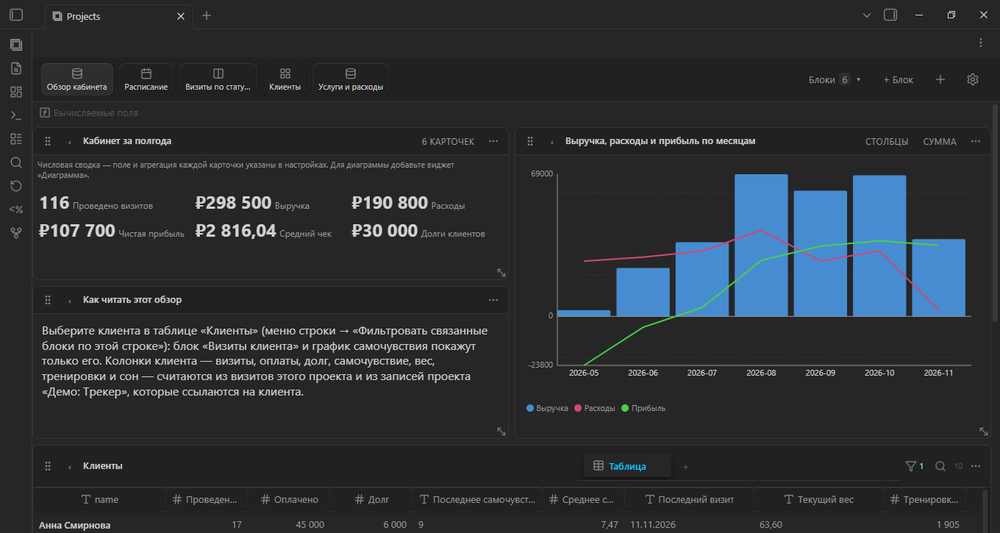
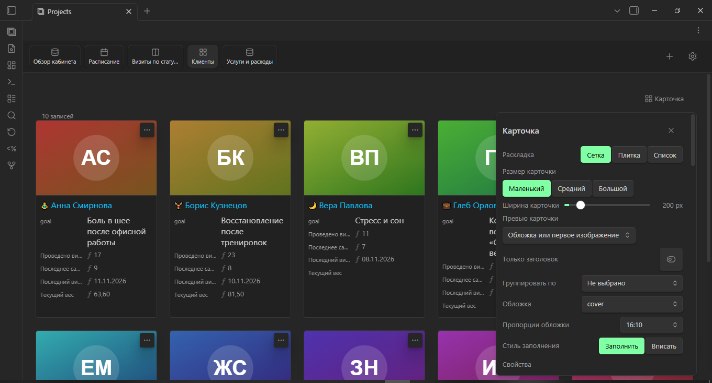
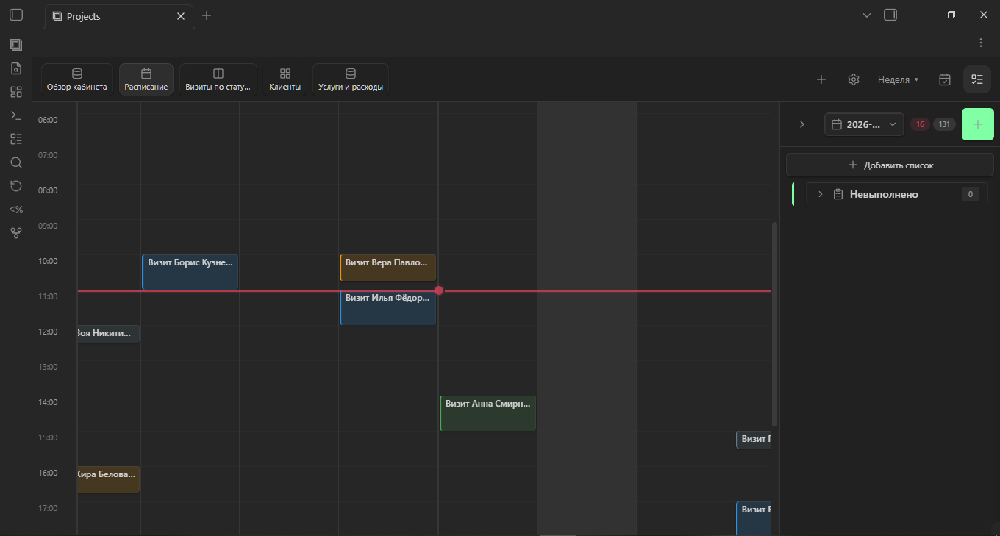
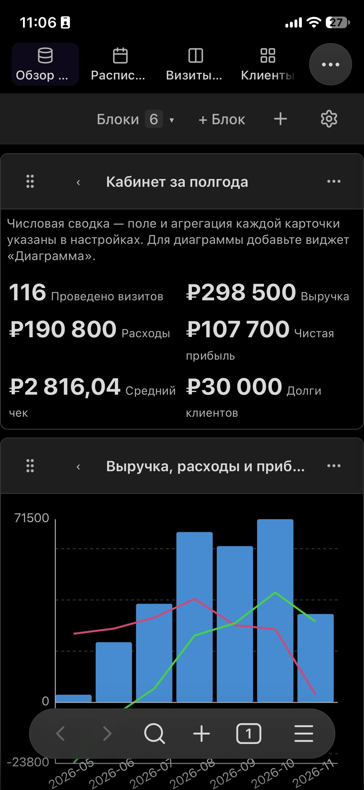
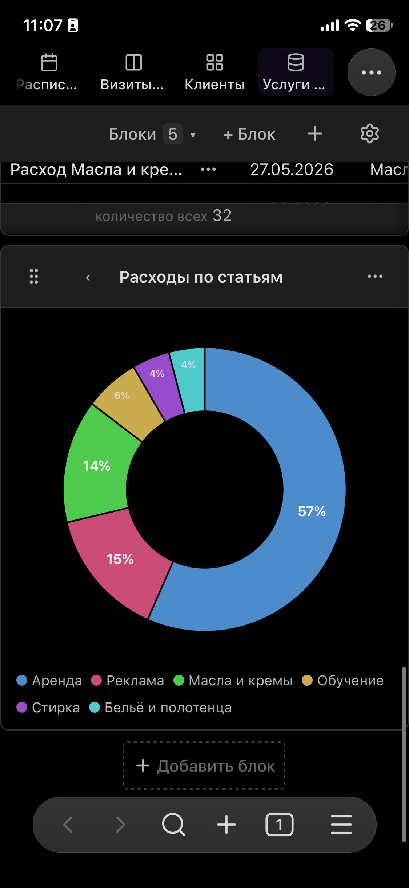
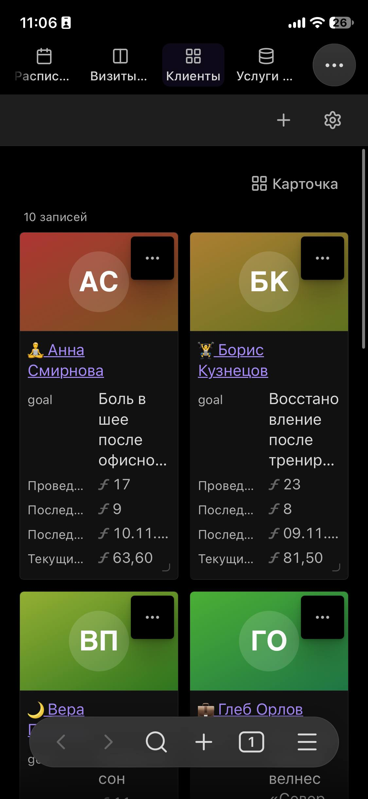

# Projects Plus

**Your notes. A working system.** Boards, calendars, galleries and dashboards — inside Obsidian, built from ordinary Markdown files.

[](https://github.com/ParkPavel/obs-projects-plus/releases/latest) [](https://obsidian.md/) [](https://github.com/ParkPavel/obs-projects-plus/releases) [](LICENSE)

[](https://web.tribute.tg/d/Sh6)

[Русский](README-RU.md) · [Website & ideas](https://parkpavel.github.io/obs-projects-plus/en.html) · [User guide](docs/user-guide-EN.md) · [Documentation](docs/README.md) · [Roadmap](ROADMAP.md)

Projects Plus helps you work with Obsidian notes as a project: compare records in a table, arrange them on a board, plan events in a calendar, and build an overview on a Dashboard.

Each record remains a Markdown file. Fields such as status, date, and assignee live in note properties — the YAML block at the beginning of the file. Editing an ordinary writable field in the plugin updates the note.

Dashboard formulas add calculated columns to the data shown in a view. They are read-only and do not write formula results to the source notes.

## Release 3.7.2

**3.7.2** brings one strict formula engine with verified migration backups, editable checkboxes on board cards, and mobile forms that keep fields and actions reachable above the keyboard. Inline palettes and computed properties share their form's scrolling area.

Download the matching assets from [GitHub Releases](https://github.com/ParkPavel/obs-projects-plus/releases/latest). Read the [3.7.2 release guide](docs/release-3.7.2.md), especially the formula migration notes, before updating an existing vault.

See the [changelog](CHANGELOG.md) and the [updating and rollback guide](docs/upgrade.md) before updating an existing vault.

## What you can do

| Task | Tool |
| --- | --- |
| Compare records and edit their properties | A table inside a Dashboard block |
| Organize tasks by status | Board with draggable cards |
| Browse meetings and deadlines | Calendar with year-to-day views |
| Browse materials by cover image | Gallery |
| Combine records, charts, metrics, and calculated columns | Dashboard with configurable blocks |
| Total up related records | Rollups through a relation, and reverse ones — records that link here |
| Compare figures across projects | Charts with several series, another project's data and a second axis |
| Select the notes to include | Folder, tag, built-in filtered query, or Dataview |

## See it in action

Real app captures supplied by the maintainer on 14 November 2026. Select an image to open the original, or browse all 14 in the website carousels.

### Desktop

| Dashboard | Gallery | Schedule |
| --- | --- | --- |
| [](images/pc/2026-11-14_11-00-55.png) | [](images/pc/2026-11-14_11-03-25.png) | [](images/pc/2026-11-14_11-02-44.png) |

### iPhone

| Overview | Charts | Cards |
| --- | --- | --- |
| [](images/mobile/photo_7_2026-11-14_11-10-08.jpg) | [](images/mobile/photo_3_2026-11-14_11-10-08.jpg) | [](images/mobile/photo_4_2026-11-14_11-10-08.jpg) |

[← Open the desktop and iPhone carousels →](https://parkpavel.github.io/obs-projects-plus/en.html#screenshots)

Swipe, arrows and image zoom are available on the website. GitHub README uses compatible image galleries. Appearance depends on your Obsidian theme and settings.

## Installation

If Projects Plus is available in the Obsidian Community plugins browser, install it from **Settings → Community plugins → Browse**: search for **Projects Plus**, then select **Install** and **Enable**.

To install a release by hand:

Download a published build from [GitHub Releases](https://github.com/ParkPavel/obs-projects-plus/releases). Use the release notes and [changelog](CHANGELOG.md) to check which features are included. Projects Plus requires Obsidian 1.8.7 or newer.

1. Choose a release and download **all three files** from it: `main.js`, `manifest.json`, and `styles.css`.
2. Create `.obsidian/plugins/obs-projects-plus/` inside your vault and place the files there. If you use a custom Obsidian configuration folder, use that folder instead of `.obsidian`.
3. Restart Obsidian and enable **Projects Plus** in Community plugins settings.

When updating, replace these three files with files from the same build. Keep `data.json`: it contains your project and view settings.

## Usage

Create your first project:

1. Create a `Projects` folder in your vault and a note named `First task.md` inside it:

   ```yaml
   ---
   title: First step
   status: todo
   startDate: 2026-09-15
   ---
   ```

2. Open the Obsidian command palette and find **Create new project plus**.
3. Name the project, choose **Folder** as its source, and select `Projects`.
4. Open it with **Show projects plus**. Use the add-view control to add a view; for a table, use a data block on a Dashboard.
5. Change the record's `status`, then open its Markdown file: the updated value should be stored in its properties.

To explore prepared data, use **Create demo project**: it creates three linked projects — a massage practice, a wellbeing tracker and a personal budget — whose data flows between them. The welcome dialog and the empty projects screen offer it too. A separate [demo vault](demo-vault/README.md) is also available.

## Privacy and access

Projects Plus works with your vault through the Obsidian API. It has no separate server or telemetry. External image and cover URLs may load over the network; use images stored in your vault for local-only content.

- **Vault files.** To find the notes of a project and the records that link to one another, it lists the files in the vault and reads their properties. It writes to a note only when you edit a record, create one, or run an action such as creating the demo.
- **Clipboard.** It writes when you explicitly copy a formula debug report or startup report; it does not read the clipboard.
- **Settings.** Projects and views are stored in the plugin's `data.json` inside your vault.

## Continue

- [User guide](docs/user-guide-EN.md): sources, views, filters, templates, and troubleshooting.
- [Updating and rolling back](docs/upgrade.md): installation, backups and workflow checks.
- [Note templates](templates/README.md): examples for tasks, meetings, and reviews.
- [Roadmap](ROADMAP.md): what comes next.
- [Changelog](CHANGELOG.md) and [issue tracker](https://github.com/ParkPavel/obs-projects-plus/issues).
- [Contributing](CONTRIBUTING.md) and [custom view API](docs/api.md).

See [Contributing](CONTRIBUTING.md) to report a reproducible issue, improve the documentation or contribute code. Release notes describe the behaviour and limits of each published version.


## Support Projects Plus

If the plugin helps you organize your work, support Park Pavel’s open-source project: new features, fixes and documentation.

[♡ Support via Tribute →](https://web.tribute.tg/d/Sh6) · [Suggest an improvement](https://github.com/ParkPavel/obs-projects-plus/issues/new) · [Contribute](CONTRIBUTING.md)

Projects Plus is based on Marcus Olsson's [Obsidian Projects](https://github.com/marcusolsson/obsidian-projects). The current maintainer is Park Pavel. Licensed under [Apache 2.0](https://github.com/ParkPavel/obs-projects-plus/blob/main/LICENSE); see [NOTICE](https://github.com/ParkPavel/obs-projects-plus/blob/main/NOTICE) for attribution.
